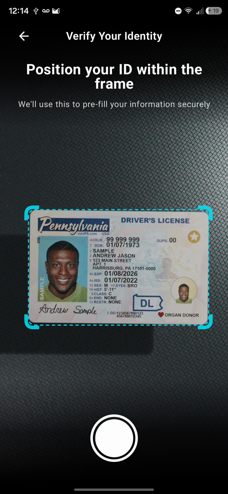

# Card Detector

Detect, track, and crop cards in an Android camera or video feed with Jetpack Compose, CameraX, and on-device YOLO inference. Use the resulting bitmap in your own OCR or document-processing pipeline. Temporal lock-on means visual stability; it does not establish document authenticity or identity.

**[Documentation website](https://lambdawalker.github.io/android.apexfission.carddetector/)** · **[Installation](IMPORT.md)** · **[AI integration](docs/agents/index.md)** · **[Demo catalog](docs/agents/demos.md)**

**Versioned guides:** [English](https://lambdawalker.github.io/android.apexfission.carddetector/en/) · [Español](https://lambdawalker.github.io/android.apexfission.carddetector/es/). Select the module and release independently; installation pages show the confirmed destinations for that exact version.

## See it in motion

[](https://lambdawalker.github.io/android.apexfission.carddetector/demos/)

Watch the [screen recording with playback controls](https://lambdawalker.github.io/android.apexfission.carddetector/demos/), or [download the original recording](https://github.com/lambdawalker/android.apexfission.carddetector/raw/main/docs/demo.mp4). This September 17, 2026 recording illustrates the moving guide; its capture commit/device configuration is unknown. It is not a benchmark or current-release test.

## Integrate

Use the confirmed coordinates generated in [IMPORT.md](IMPORT.md). Choose the `carddetector` module for your own compatible model or `tfmodel` for bundled assets and its pinned compatible detector. Artifact names and repository requirements vary by destination; copy the generated installation example rather than combining old and new coordinates. The [complete quickstart](docs/agents/quickstart.md) includes imports, permission handling, and explicit bitmap cleanup.

- Single-side detection and retained-best capture: `CardDetectorLite`.
- Single-side manual/automatic capture with review and retake: [`SingleSideCardCapture`](docs/agents/recipes.md#single-side-automatic-capture).
- Front/back capture with review, retakes, and optional automatic capture: [`TwoSidedCardCapture`](docs/agents/recipes.md#capture-both-sides).
- Recorded video: `CardTrackingSimulator`.
- Presentation: `IdCaptureOverlay`, custom scoped controls, and animation helpers.
- Configuration: detector/camera presets, preprocessing, and `CardValidator`.
- Without Compose: `buildCardDetector` and synchronous `track` overloads.

Every delivered callback bitmap belongs to the host. Recycle after final use. `CardDetectorLite` detection/capture callbacks run on worker threads; detection delivery can skip pending results and capture uses a retained best image. `SingleSideCardCapture` transfers one confirmed crop once on the main thread after review; retake discards an unconfirmed image. Two-sided capture uses fresh crops and transfers the confirmed front/back pair on the main thread. Read [ownership and lifecycle](docs/agents/concepts.md).

## Repository

| Module | Purpose |
| --- | --- |
| `:carddetector` | Core, camera/video adapters, tracking, overlays, optional OCR wrapper |
| `:tfmodel` | Sentinel model assets and `ModelCatalog.TfLite` extensions |
| `:app` | Welcome catalog, single-side automatic capture, manual/automatic two-sided capture, video simulation, and minimal quickstart |

YOLO and coordinates come from Maven Central; the demo permissions dependency comes from JitPack. No sibling checkouts or submodules are required. Use JDK 21 for the Gradle daemon, JDK 17 for compilation, and Android SDK 37. Hydrate models and media with `git lfs pull`. See [testing prerequisites and dependency compatibility](docs/maintenance.md#android-verification).

```bash
./gradlew :carddetector:testDebugUnitTest :app:assembleDebug
cd sites
npm ci
npm run check
```

The existing unversioned guides describe **main development source**. The versioned site preserves release-specific guides and source links in English and Spanish. Published installation facts come independently from confirmed release metadata. See [maintenance](docs/maintenance.md), [coverage](docs/coverage.md), and the [release runbook](docs/releases.md). Apache-2.0; see [LICENSE](LICENSE).

## Independent releases

Use **Publish carddetector** or **Publish tfmodel**, then select the destination repository. Configure destinations in `.project/setup/repositories.yml`; run `setup.bat` (Windows) or `./setup.sh` (Linux/macOS) to select modules and configure environments. See [the release runbook](docs/releases.md).

## Repository setup

Publishing and setup use the configured shared CLI pin with Gradle plugins v0.1.14 for both libraries. See [setup, environments and release recovery](docs/releases.md). The CLI restores the selected libraries/apps and generates their independent workflows.

Launch setup from any working directory:

```bat
setup.bat
setup.bat workflows --check
```

```sh
./setup.sh
./setup.sh workflows --check
```

Run `setup.bat` on Windows or `sh ./setup.sh` on Linux/macOS. These shared CLI-generated launchers install and verify the configured CLI, cache it under `.project/setup/cache/`, and forward arguments. Release pins use verified binaries; full commit pins require Cargo and build the exact source. Run `setup check` to validate generated files and evaluated module configuration.


## Documentation tooling

Documentation is maintained by the independently pinned `android-repo-docs` executable.
Use `sh ./docs.sh check` on Linux/macOS or `docs.bat check` on Windows.
The launcher installs the configured release or immutable source revision on first use;
source pins require Rust and Git. No setup credentials are needed.

- `sh ./docs.sh sources check` verifies reviewed Kotlin inputs and examples.
- `sh ./docs.sh sources update` intentionally refreshes generated references and examples; review the diff.
- `sh ./docs.sh build --check` builds the existing documentation site locally.
- `sh ./docs.sh bootstrap check` verifies the launcher files against their independent pin.

Configuration and project-specific introductory Markdown live in `.project/docs/`.
Confirmed release records and archived source identities remain authoritative.
Documentation checks do not accept images, publish artifacts, or deploy the site.
