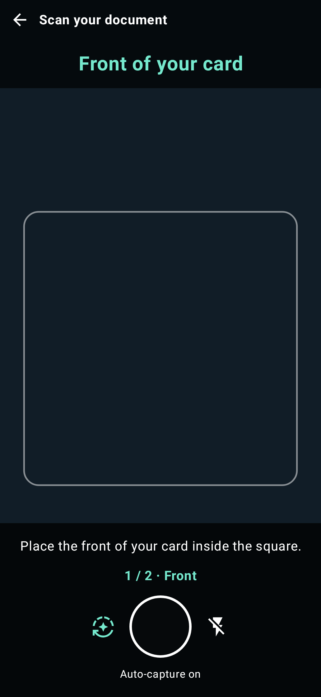
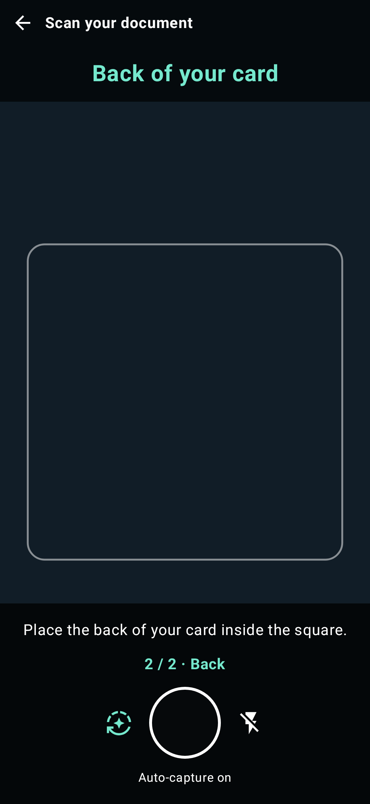
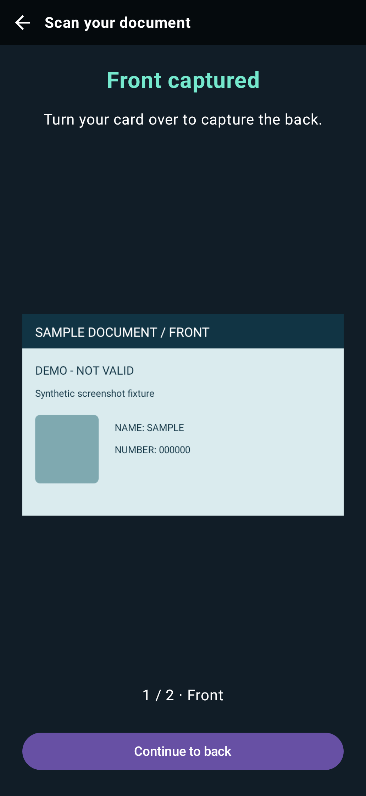
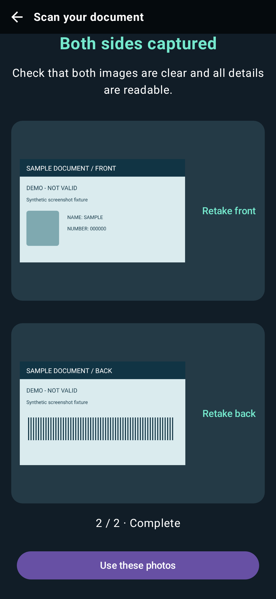

# See detection in motion

The primary showcase is the supplied **demo.mp4**, approximately 31 seconds at 1080 × 2340. Watch the moving guide around the sample card; individual stills cannot show tracking behavior. The recording predates this documentation update. Its original capture commit, device and rendering configuration are unknown, so it is historical illustrative media, not a current-release test or performance benchmark.

<!-- recording-player -->

[Download the original recording](../demo.mp4).

## Visual description

The portrait recording shows the card-scanning interface with a back arrow, instructions, guide, and shutter. A sample card is presented in the preview; the outline follows its position. Still frames below show specific moments. This demonstrates visible guidance only; it does not demonstrate successful OCR, uploads, document authenticity, or a measured accuracy/FPS result. There is no narrated audio track.

Historical recording frame at **12 seconds**, showing the cyan outline around the sample card. See [media provenance and regeneration](../screenshots/README.md).

## Current screen previews

These Compose previews show the front/back capture flow using synthetic card data, at 393 × 852 dp. They are rendered on the host from source `68a49850d253`, not captured from a camera device. See [render provenance and hashes](../screenshots/ui-manifest.json) and [how to regenerate candidates](../screenshots/README.md#render-current-ui-states-on-the-host).

| Front guide | Back guide |
| --- | --- |
|  |  |

| Turn over the card | Review and retake |
| --- | --- |
|  |  |

## Runnable examples

Prerequisites: Android API 28+ device, repository Android toolchain, hydrated LFS assets (`git lfs pull`), and `./gradlew :app:installDebug`. Inference and camera behavior need device testing; a site build alone does not validate them.

| Demo | Launch / action | Expected behavior | Recovery and source |
| --- | --- | --- | --- |
| Welcome / demo catalog | Open launcher or `adb shell am start -n com.apexfission.android.carddetector.demo/.WelcomeActivity` | Four demo buttons; no camera permission requested on this screen | Back from a demo returns to the catalog; [source](../../app/src/main/java/com/apexfission/android/carddetector/demo/WelcomeActivity.kt) |
| Minimal integration | `adb shell am start -n com.apexfission.android.carddetector.demo/.DocumentationQuickstartActivity` → grant permission → present sample card → shutter | Guide and capture dimensions; both callback images explicitly released | Denial → retry or Settings; [complete source](../../app/src/main/java/com/apexfission/android/carddetector/demo/DocumentationQuickstartActivity.kt) |
| Two-sided capture | Choose manual or automatic capture on the welcome screen; direct `.CardDetectionActivity` launch defaults to automatic | Front → Continue to back → back → review/retake → return to welcome after confirmation | Camera permission requested on entry; [source](../../app/src/main/java/com/apexfission/android/carddetector/demo/CardDetectionActivity.kt) |
| Recorded-video simulator | `adb shell am start -n com.apexfission.android.carddetector.demo/.CardDetectionSimulationActivity` | Plays packaged `raw/x.mp4`; moving detection guide and capture controls, no camera permission or flashlight | Blank video → check LFS/readable URI; [source](../../app/src/main/java/com/apexfission/android/carddetector/demo/CardDetectionSimulationActivity.kt) |

The simulator's [MainViewModel](../../app/src/main/java/com/apexfission/android/carddetector/demo/MainViewModel.kt) contains placeholder cloud/on-device OCR methods. It is a wiring example, not a production OCR queue. Prefer the quickstart and ownership recipe for new integrations. The recorded showcase is a separate asset from the simulator's input video; do not feed UI screen recordings back into the simulator as if they were raw camera fixtures.

## Screenshots and tests

The accepted image above is deterministically extracted from the supplied video, with timestamp, input hash, tool configuration, and pixel hash in the media manifest. It is not a newly captured app screenshot. Current device screenshots are optional; no device screenshot baseline is claimed. Existing image-test outputs concern detector fixtures and are not silently repurposed as UI evidence. See [maintenance](../maintenance.md) for candidate/update/verify commands.
