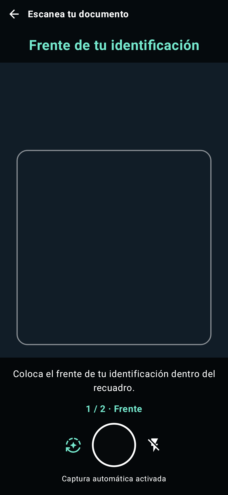
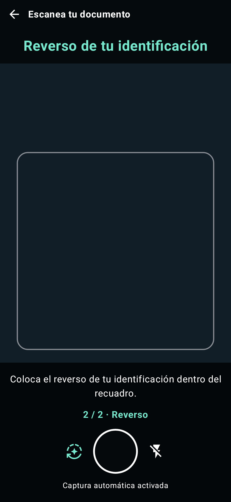
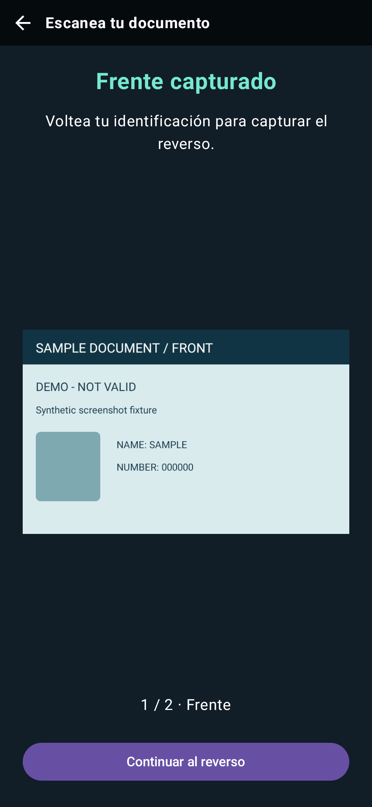
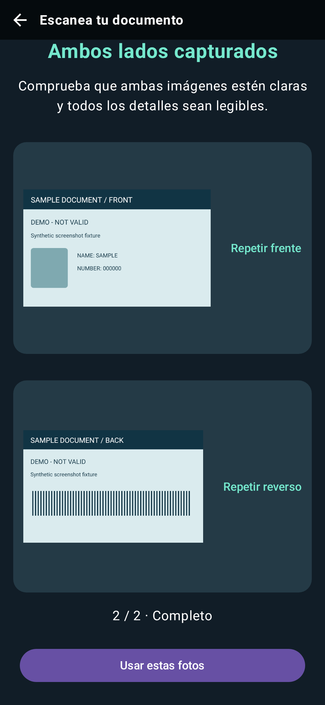

# Ver la detección en movimiento

La demostración principal es el **demo.mp4** suministrado, de unos 31 segundos y 1080 × 2340. Observe la guía móvil alrededor de la tarjeta de ejemplo; las imágenes fijas individuales no muestran el comportamiento del seguimiento. La grabación es anterior a esta actualización de la documentación. Se desconocen el commit original de captura, el dispositivo y la configuración de renderizado, por lo que es material histórico ilustrativo, no una prueba de la versión actual ni una medición de rendimiento.

<!-- recording-player -->

[Descargar la grabación original](../demo.mp4).

## Descripción visual

La grabación vertical muestra la interfaz de escaneo de tarjetas con una flecha de retroceso, instrucciones, guía y disparador. Se presenta una tarjeta de ejemplo en la vista previa; el contorno sigue su posición. Las imágenes fijas siguientes muestran momentos concretos. Solo demuestra la guía visible; no demuestra OCR correcto, cargas de datos, autenticidad de documentos ni resultados medidos de precisión o FPS. No hay una pista de audio narrada.

Fotograma de la grabación histórica a los **12 segundos**, que muestra el contorno cian alrededor de la tarjeta de ejemplo. Consulte la [procedencia y regeneración del material multimedia](../screenshots/README.md).

## Vistas previas actuales

Estas vistas de Compose muestran la captura de frente y reverso con datos sintéticos, a 393 × 852 dp. Se renderizan en el equipo anfitrión desde el código `68a49850d253`; no son capturas de un dispositivo con cámara. Consulte la [procedencia y los hashes](../screenshots/ui-manifest.json) y [cómo regenerar candidatos](../screenshots/README.md#render-current-ui-states-on-the-host).

| Guía del frente | Guía del reverso |
| --- | --- |
|  |  |

| Dar la vuelta | Revisar y repetir |
| --- | --- |
|  |  |

## Ejemplos ejecutables

Requisitos: dispositivo con Android API 28+, cadena de herramientas Android del repositorio, recursos LFS descargados (`git lfs pull`) y `./gradlew :app:installDebug`. La inferencia y el comportamiento de la cámara requieren pruebas en un dispositivo; compilar el sitio por sí solo no los valida.

| Demostración | Inicio / acción | Comportamiento esperado | Recuperación y código fuente |
| --- | --- | --- | --- |
| Bienvenida / catálogo de demos | Abrir el lanzador o `adb shell am start -n com.apexfission.android.carddetector.demo/.WelcomeActivity` | Cuatro botones de demos; esta pantalla no solicita permiso de cámara | Volver desde una demo regresa al catálogo; [código fuente](../../app/src/main/java/com/apexfission/android/carddetector/demo/WelcomeActivity.kt) |
| Integración mínima | `adb shell am start -n com.apexfission.android.carddetector.demo/.DocumentationQuickstartActivity` → conceder permiso → presentar tarjeta de ejemplo → disparador | Guía y dimensiones de captura; ambas imágenes de los callbacks se liberan explícitamente | Denegación → volver a intentar o Ajustes; [código fuente completo](../../app/src/main/java/com/apexfission/android/carddetector/demo/DocumentationQuickstartActivity.kt) |
| Captura de ambos lados | Elegir captura manual o automática en la bienvenida; iniciar `.CardDetectionActivity` directamente usa captura automática | Frente → Continuar al reverso → reverso → revisión/repetición → volver a bienvenida al confirmar | Solicita permiso de cámara al entrar; [código fuente](../../app/src/main/java/com/apexfission/android/carddetector/demo/CardDetectionActivity.kt) |
| Simulador de vídeo grabado | `adb shell am start -n com.apexfission.android.carddetector.demo/.CardDetectionSimulationActivity` | Reproduce el `raw/x.mp4` incluido; guía de detección móvil y controles de captura, sin permiso de cámara ni linterna | Vídeo en blanco → comprobar LFS y que la URI sea legible; [código fuente](../../app/src/main/java/com/apexfission/android/carddetector/demo/CardDetectionSimulationActivity.kt) |

El [MainViewModel](../../app/src/main/java/com/apexfission/android/carddetector/demo/MainViewModel.kt) del simulador contiene métodos de ejemplo de OCR en la nube y en el dispositivo. Es un ejemplo de conexión entre componentes, no una cola de OCR para producción. Para nuevas integraciones, prefiera el inicio rápido y la receta de propiedad. La grabación de demostración es un recurso distinto del vídeo de entrada del simulador; no introduzca grabaciones de pantalla de la interfaz en el simulador como si fueran datos de prueba de cámara sin procesar.

## Capturas de pantalla y pruebas

La imagen aceptada anterior se extrae de forma determinista del vídeo suministrado, con la marca temporal, el hash de entrada, la configuración de herramientas y el hash de píxeles en el manifiesto multimedia. No es una captura de pantalla nueva de la aplicación. Las capturas actuales de dispositivos son opcionales; no se afirma disponer de una referencia de capturas de dispositivo. Las salidas existentes de pruebas de imágenes corresponden a datos de prueba del detector y no se reutilizan implícitamente como pruebas de la interfaz. Consulte [mantenimiento](../maintenance.md) para los comandos de generación de candidatos, actualización y verificación.
